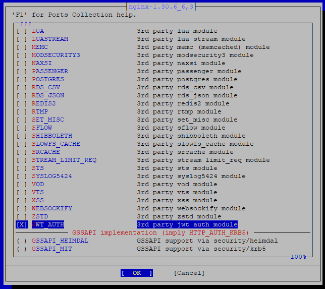

# FreeBSD NGINX Port with JWT Authentication Module

This repository provides instructions and automation scripts to build the official FreeBSD `www/nginx` port with the third-party [`nginx-auth-jwt`](https://github.com/kjdev/nginx-auth-jwt) module included.

## Source Module

- **GitHub Repository:** [kjdev/nginx-auth-jwt](https://github.com/kjdev/nginx-auth-jwt)
- **GitHub Repository:** [lexsysko/port_nginx_add_jwt_auth](https://github.com/lexsysko/port_nginx_add_jwt_auth)

---

## Patching the FreeBSD NGINX Port

### Fetch the FreeBSD ports tree:

```bash
git clone --depth 1 https://git.FreeBSD.org/ports.git /usr/ports
```

You can apply the necessary changes either automatically using the helper script or manually.

### Option A: Automatic Script (Recommended)

```bash
cd ~
git clone https://github.com/lexsysko/port_nginx_add_jwt_auth
cd ./port_nginx_add_jwt_auth
chmod +x ./apply_changes_nginx_jwt.sh
./apply_changes_nginx_jwt.sh
```

### Option B: Manual Patching

Navigate to the NGINX port directory and apply your patch files:
```bash
cd /usr/ports/www/nginx
patch -u -p1 < patch-file
```

---

## Building and Installing the Port

1. Open the port configuration menu:
```bash
cd /usr/ports/www/nginx
make config
```



2. Select the **JWT_AUTH** option under third-party modules.

3. Build and install the port:
	```bash
	make
	make install
	```

4. Verify that the module shared library was successfully installed:
	```bash
	ls -l /usr/local/libexec/nginx/ngx_http_auth_jwt_module.so
	```

---

## Creating Custom Patches

To generate a patch file by comparing an original file with a modified version:

```bash
diff -u original_file modified_file > patch-file
```
---

## Restoring Port Changes

To revert your changes to the FreeBSD ports tree, run the cleanup script or use Git:

```bash
./apply_changes_nginx_jwt.sh
```

Alternatively:

```bash
git restore /usr/ports/www/nginx
```

---

## Tested Environments

* **OS:** FreeBSD 14.5
* **Module Version:** `nginx-auth-jwt` release-0.15.0
* **NGINX Port Version:** `nginx-1.30.6_6,3`

